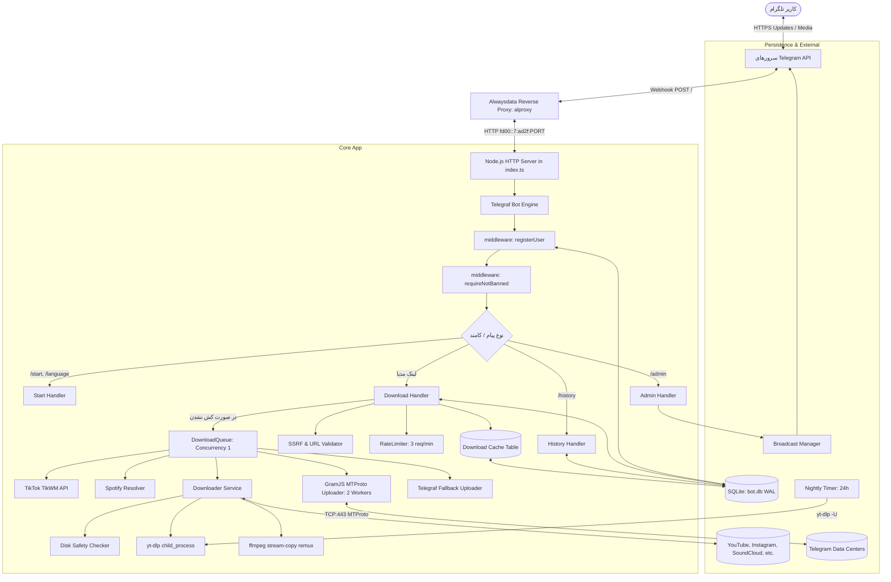
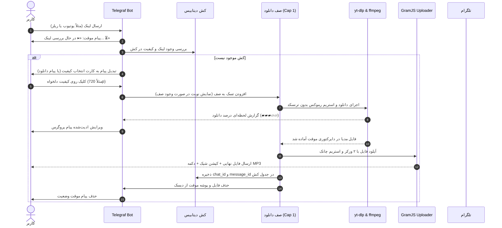
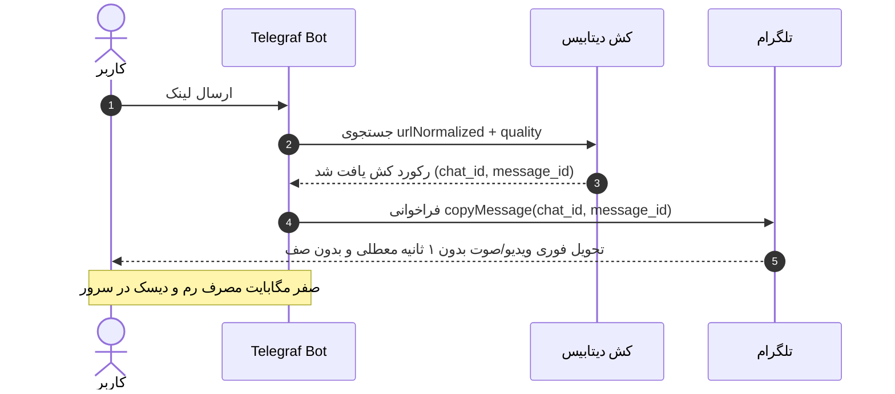
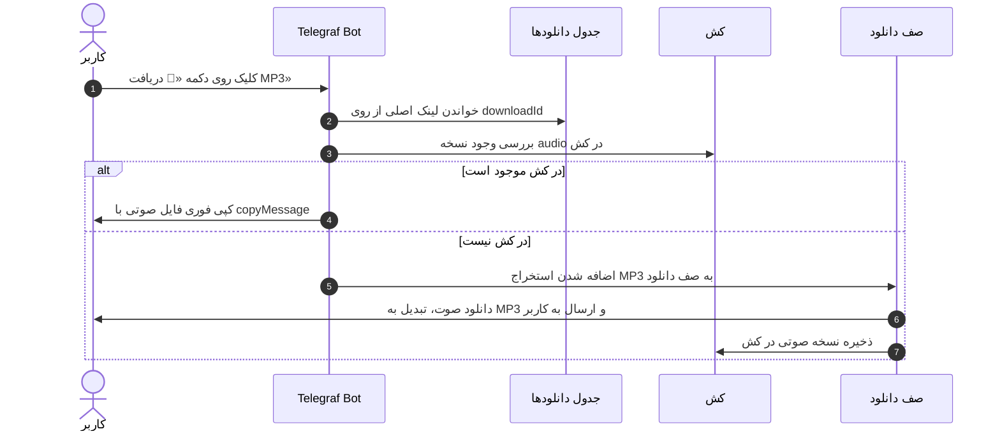
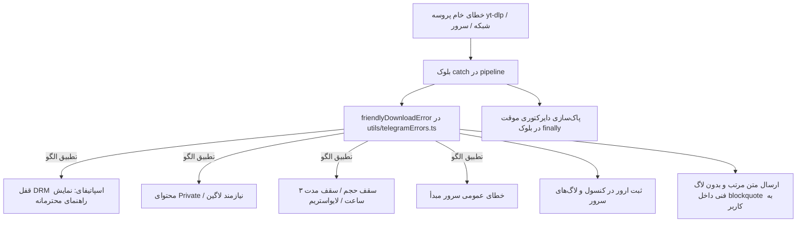
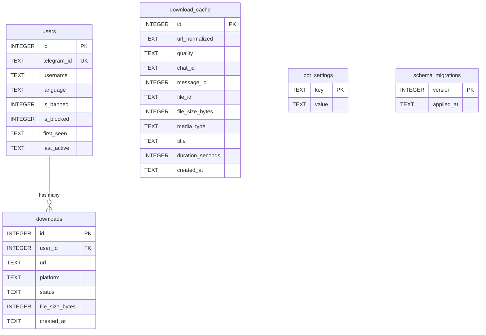
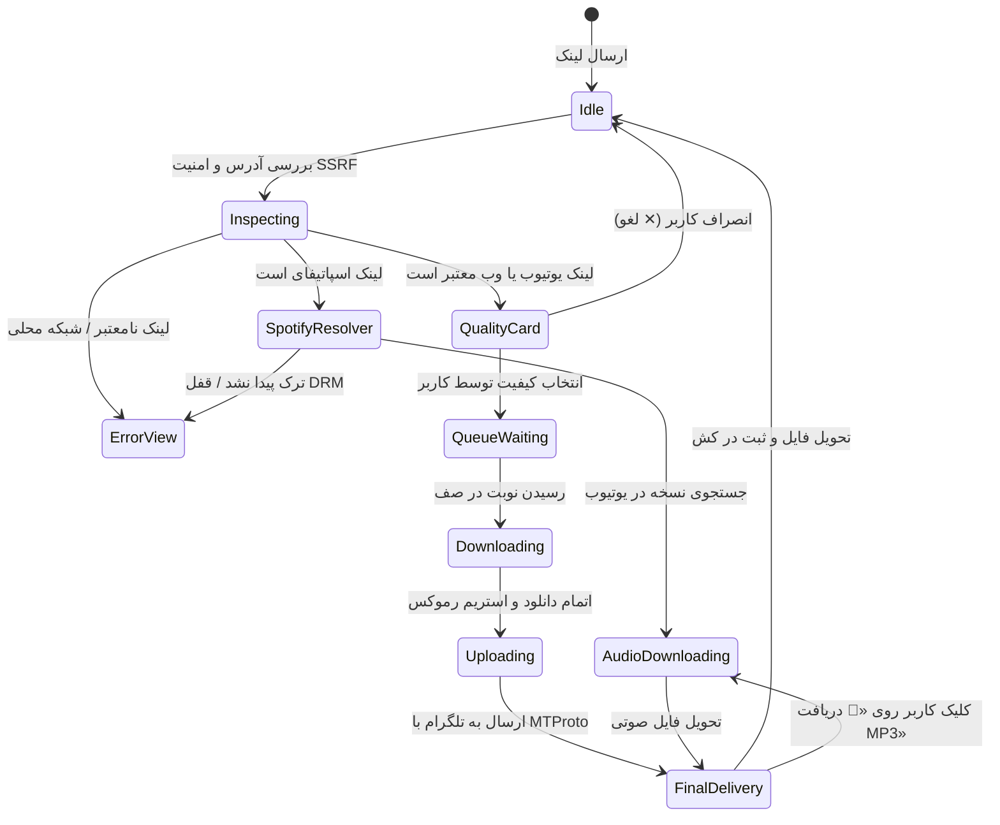

# مستند جامع فنی و معماری پروژه میمو (Mimo Bot Overview)

این سند مرجع کامل فنی، معماری و عملیاتی ربات تلگرامی «mimo» است و برای مطالعه و توسعه توسط مهندسین نرم‌افزار و مدل‌های هوش مصنوعی تدوین شده است.

---

## ۱. خلاصه (Summary)

- **کاربرد ربات:** دریافت لینک از شبکه‌های اجتماعی و وب‌سایت‌ها، دانلود مدیا (ویدیو، عکس، صوت) با کیفیت مناسب و ارسال پرسرعت آن به کاربر در تلگرام بدون نیاز به نرم‌افزار جانبی.
- **مخاطب:** کاربران عمومی تلگرام با تمرکز بر رابط کاربری فارسی، روان، تمیز و مینیمال.
- **محیط میزبان:** سرور اشتراکی لینوکسی Alwaysdata با محدودیت‌های شدید منابع: ۲۵۶ مگابایت رم، ۱ گیگابایت سهمیه دیسک و صف پردازش با ظرفیت اجرای هم‌زمان ۱ (`concurrency: 1`).
- **پشته فناوری (Tech Stack):**
  - **Node.js:** نگارش `>=18` (اجرا با Node v24) [package.json:15]
  - **TypeScript:** نگارش `^7.0.2` [package.json:28] با ساختار کامپایل ماژولار NodeNext [tsconfig.json:4]
  - **Telegraf:** نگارش `^4.16.3` [package.json:20] جهت مدیریت وب‌هوک و پاسخگویی به پیام‌های تلگرام
  - **GramJS (telegram):** نگارش `^2.26.22` [package.json:21] جهت آپلود پرسرعت فایل‌های حجیم با پروتکل بومی MTProto
  - **SQLite (better-sqlite3):** نگارش `^12.2.0` [package.json:18] در حالت WAL با مدیریت مایگریشن نسخه‌بندی‌شده
  - **yt-dlp:** باینری مستقل پایتون مستقر در سرور [src/services/dependencies.ts:14] (نسخه سرور: `2026.08.19`)
  - **ffmpeg:** باینری استاتیک نسخه `7.0.2-static` مستقر در `~/bin/ffmpeg` [src/services/downloader.ts:88-91]

---

## ۲. ساختار فایل‌ها (File Tree)

```text
mimo/
├── package.json             # تعاریف وابستگی‌ها، اسکریپت‌های بیلد و تست [package.json:1]
├── tsconfig.json            # پیکربندی کامپایلر تایپ‌اسکریپت و مسیرهای خروجی dist [tsconfig.json:1]
├── README.md                # مستندات معرفی و متغیرهای پیکربندی پروژه [README.md:1]
├── TODO.md                  # چک‌لیست وضعیت تسک‌های پیاده‌سازی‌شده و آینده [TODO.md:1]
├── scripts/
│   ├── askpass.bat          # اسکریپت محلی برای تزریق پسورد در اجرای SSH بدون ترمینال
│   ├── setup.sh             # اسکریپت شل نصب وابستگی‌های لینوکس و مک [scripts/setup.sh:1]
│   └── setup.ps1            # اسکریپت پاورشل راه‌اندازی ویندوز [scripts/setup.ps1:1]
├── src/
│   ├── index.ts             # نقطه ورود برنامه، راه‌اندازی سرور HTTP وب‌هوک و هندلر خروج امن [src/index.ts:25]
│   ├── config.ts            # اعتبارسنجی متغیرهای محیطی با Zod و تعریف مقادیر پیش‌فرض [src/config.ts:10]
│   ├── admin/
│   │   ├── broadcast.ts     # مدیریت ارسال دسته‌ای ۱۰۰ کاربر با کنترل لغو و ۴۲۹ [src/admin/broadcast.ts:6]
│   │   ├── errorAlerts.ts   # سیستم تجمیع و ارسال هشدارهای خطای پلتفرم به ادمین [src/admin/errorAlerts.ts:14]
│   │   ├── handlers.ts      # کنترلرهای منوی ادمین، آمار، مدیریت کاربران و کش [src/admin/handlers.ts:25]
│   │   └── menus.ts         # کیبوردهای اینلاین پنل مدیریت تلگرام [src/admin/menus.ts:3]
│   ├── bot/
│   │   ├── commands.ts      # ثبت دستورات منوی تلگرام و اسکوپ اختصاصی ادمین [src/bot/commands.ts:4]
│   │   ├── createBot.ts     # ترکیب میان‌افزارها، ثبت دستورات منوی تلگرام و هندلرها [src/bot/createBot.ts:29]
│   │   ├── handlers/
│   │   │   ├── download.ts  # هسته پردازش لینک‌ها، ساخت کارت کیفیت، پروگرس و ارسال مدیا [src/bot/handlers/download.ts:74]
│   │   │   ├── history.ts   # هندلر نمایش تاریخچه دانلودهای کاربر به تفکیک پلتفرم [src/bot/handlers/history.ts:18]
│   │   │   └── start.ts     # پیام خوش‌آمدگویی ریتمیک و دکمه انتخاب زبان [src/bot/handlers/start.ts:13]
│   │   └── middleware/
│   │       ├── registerUser.ts   # ثبت و به‌روزرسانی خودکار مشخصات کاربر در دیتابیس [src/bot/middleware/registerUser.ts:5]
│   │       └── requireNotBanned.ts# فیلتر مسدودسازی کاربران بن‌شده از ارسال درخواست [src/bot/middleware/requireNotBanned.ts:4]
│   ├── database/
│   │   ├── client.ts        # ساخت اتصال SQLite و اعمال بهینه‌سازی‌های رم (WAL, cache_size) [src/database/client.ts:4]
│   │   ├── migrations.ts    # اجرای ترتیبی و امن مایگریشن‌های اس‌کیولایت [src/database/migrations.ts:71]
│   │   ├── migrations/      # فایل‌های خام اسکریپت‌های تغییر اسکیمای دیتابیس (نسخه‌های ۱ تا ۵)
│   │   └── repositories/
│   │       ├── cache.ts     # مخزن خواندن، نوشتن و پاک‌سازی کش مدیاهای دانلودشده [src/database/repositories/cache.ts:29]
│   │       ├── downloads.ts # ثبت سوابق دانلود و استخراج تاریخچه تفکیکی کاربران [src/database/repositories/downloads.ts:21]
│   │       ├── settings.ts  # مخزن ذخیره تنظیمات داینامیک نظیر جوین اجباری [src/database/repositories/settings.ts:3]
│   │       └── users.ts     # عملیات جدول کاربران (ثبت، آمار، لیست، بن، زبان) [src/database/repositories/users.ts:22]
│   ├── services/
│   │   ├── dependencies.ts  # بررسی باینری‌ها و آپدیت شبانه yt-dlp بدون ری‌استارت [src/services/dependencies.ts:21]
│   │   ├── downloader.ts    # سرویس اصلی دانلود مدیا، استخراج متادیتا و کنترل سقف‌ها [src/services/downloader.ts:133]
│   │   ├── downloadQueue.ts # صف ترتیبی دانلود با ظرفیت ۱ و سقف ۱ تسک فعال به ازای کاربر [src/services/downloadQueue.ts:3]
│   │   ├── forceJoin.ts     # سرویس بررسی عضویت اجباری در کانال و حفظ لینک [src/services/forceJoin.ts:18]
│   │   ├── gramjsMonitor.ts # پایش خطاهای آپلودور GramJS و شمارش FLOOD_WAIT [src/services/gramjsMonitor.ts:14]
│   │   ├── metrics.ts       # جمع‌آوری و محاسبه صدک‌های ۹۵ و میانه سرعت دانلود [src/services/metrics.ts:21]
│   │   ├── mtprotoUploader.ts# آپلودور فایل‌های حجیم تلگرام با GramJS و متادیتای صوتی [src/services/mtprotoUploader.ts:24]
│   │   ├── process.ts       # اجرای ایمن پروسه‌های فرزند با spawn و گزارش لحظه‌ای پیشرفت [src/services/process.ts:22]
│   │   ├── rateLimiter.ts   # محدودکننده نرخ درخواست کاربر (Sliding Window در حافظه) [src/services/rateLimiter.ts:5]
│   │   ├── spotify.ts       # استخراج تایتل اسپاتیفای و سرچ معادل در یوتیوب [src/services/spotify.ts:9]
│   │   └── tiktok.ts        # دانلود پرسرعت بدون واترمارک تیک‌تاک با TikWM و سد شکن [src/services/tiktok.ts:47]
│   ├── types/
│   │   └── index.ts         # تعاریف تایپ‌های داده، زمینه‌های کاربری و نتایج دانلود [src/types/index.ts:1]
│   └── utils/
│       ├── disk.ts          # محاسبه سقف مجاز دانلود با در نظر گرفتن سهمیه و du دایرکتوری [src/utils/disk.ts:66]
│       ├── files.ts         # پاک‌سازی دایرکتوری‌های موقت هنگام خطا یا استارت [src/utils/files.ts:6]
│       ├── formatting.ts    # فراراکردن امن تگ‌های HTML، فرمت حجم، زمان و پروگرس‌بار [src/utils/formatting.ts:1]
│       ├── mediaUrl.ts      # تشخیص پلتفرم و اعتبارسنجی اولیه ساختار لینک [src/utils/mediaUrl.ts:34]
│       ├── ssrf.ts          # فیلتر آدرس‌های IP خصوصی، محلی و حملات DNS Rebinding [src/utils/ssrf.ts:49]
│       ├── telegramErrors.ts# تبدیل خطاهای فنی yt-dlp به پیام‌های فارسی خوانا [src/utils/telegramErrors.ts:1]
│       ├── throttler.ts     # جلوگیری از ارسال مکرر ادیت پیام به تلگرام (ضد ارور ۴۲۹) [src/utils/throttler.ts:7]
│       └── urlNormalizer.ts # حذف پارامترهای ردیابی تبلیغاتی از لینک‌ها جهت افزایش هیت کش [src/utils/urlNormalizer.ts:20]
└── tests/                   # مجموعه تست‌های واحد خودکار با رانر بومی node:test
```

---

## ۳. گراف معماری سیستم (System Architecture)



---

## ۴. گراف جریان‌ها (Flow Diagrams)

### ۴.۱. جریان دانلود عادی (Normal Download Pipeline)



### ۴.۲. جریان کش‌هیت فوری (Cache-Hit Pipeline)



### ۴.۳. جریان دانلود MP3 از دکمه زیر ویدیو



### ۴.۴. مسیر مدیریت خطا (Error Handling Path)



### ۴.۵. جریان ارسال همگانی ادمین (Admin Broadcast)

```mermaid
sequenceDiagram
    autonumber
    actor Admin as ادمین
    participant Bot as Telegraf
    participant Mgr as BroadcastManager
    participant Users as UsersRepository
    participant TG as تلگرام

    Admin->>Bot: انتخاب گزینه «▸ ارسال همگانی» در /admin
    Bot->>Admin: «پیامی که می‌خواهید به تمام کاربران ارسال شود را بفرستید...»
    Admin->>Bot: ارسال متن، عکس یا ویدیوی مورد نظر
    Bot->>Users: دریافت فهرست تمام شناسه‌های تلگرام کاربران
    Users-->>Mgr: آرایه تمام telegramId ها
    loop حلقه روی تک‌تک کاربران با تأخیر کنترلی
        Mgr->>TG: copyMessage به کاربر جاری
        Note over Mgr: هر ۲۵ کاربر یک‌بار پیام پروگرس به ادمین آپدیت می‌شود
    end
    Mgr->>Admin: «Broadcast complete. Sent to X/Y; Z failed.»
```

---

## ۵. پایگاه داده (Database)

ربات از پایگاه داده رابطه‌ای SQLite بهره می‌برد. موتور اتصال در [src/database/client.ts:10-18] با تنظیمات زیر برای محدودیت رم ۲۵۶ مگابایتی بهینه‌سازی شده است:
- `journal_mode = WAL` (هم‌زمانی خواندن بدون قفل شدن دیتابیس)
- `cache_size = -2000` (سقف حافظه کش برابر ۲ مگابایت)
- `mmap_size = 0` (عدم مصرف رم سرور برای نگاشت حافظه)
- `busy_timeout = 5000` (مهلت ۵ ثانیه‌ای رفع تراکنش قبل از ارور Busy)

### ۵.۱. نمودار موجودیت-ارتباط (ER Diagram)



### ۵.۲. جداول و ایندکس‌ها

| نام جدول | ستون‌ها | ایندکس‌ها | کاربرد در سیستم |
| :--- | :--- | :--- | :--- |
| **`users`** | `id`, `telegram_id`, `username`, `first_seen`, `is_banned`, `is_blocked`, `last_active`, `language` [src/database/migrations.ts:7-14, 56, 62] | `telegram_id UNIQUE` | نگهداری هویت، وضعیت مسدودیت، آخرین زمان فعالیت و زبان انتخابی کاربر |
| **`downloads`** | `id`, `user_id`, `url`, `platform`, `status`, `file_size_bytes`, `created_at` [src/database/migrations.ts:16-22, 30, 57] | `idx_downloads_user_created`, `idx_downloads_created` | ثبت تک‌تک درخواست‌های موفق/ناموفق جهت تاریخچه `/history` و آمار ادمین |
| **`download_cache`** | `id`, `url_normalized`, `quality`, `chat_id`, `message_id`, `file_id`, `file_size_bytes`, `media_type`, `title`, `duration_seconds`, `created_at` [src/database/migrations.ts:36-51] | `idx_cache_url_quality UNIQUE(url_normalized, quality)`, `idx_cache_created` | ذخیره مشخصات تلگرامی فایل‌های آپلودشده جهت فوروارد/کپی آنی و جلوگیری از دانلود مجدد |
| **`bot_settings`** | `key`, `value` [src/database/migrations.ts:63-66] | `key PRIMARY KEY` | ذخیره تنظیمات داینامیک ربات نظیر روشن/خاموش بودن جوین اجباری و آیدی کانال |
| **`schema_migrations`** | `version`, `applied_at` [src/database/migrations.ts:72] | `version PRIMARY KEY` | ثبت وضعیت مایگریشن‌های اعمال‌شده (نسخه فعلی: **۵**) |

---

## ۶. رابط کاربری (User Interface)

تمامی پیام‌های ارسالی به کاربران بر اساس قواعد مشخصی قالب‌بندی می‌شوند:
- استفاده سراسری از `parse_mode: "HTML"` [src/utils/throttler.ts:25].
- فراراکردن تمام متغیرهای ورودی بیرونی با `escapeHtml` [src/utils/formatting.ts:1-9].
- کنترل نرخ ویرایش پیام‌ها با ماژول Throttler با وقفه ۱.۵ تا ۲ ثانیه‌ای [src/utils/throttler.ts:16-22].
- شناسه کلیک دکمه‌ها از توکن‌های تصادفی ۸ کاراکتری (Hex) با انقضای ۱۰ دقیقه‌ای تولید می‌شود تا محدودیت ۶۴ بایتی `callback_data` تلگرام رعایت شود [src/bot/handlers/download.ts:40-45, 114].

### ۶.۱. جدول صحنه‌ها و پیام‌ها

| نام صحنه | عامل فراخوانی | متن ارسالی در تلگرام | دکمه‌ها و Callback | عملکرد پس از کلیک |
| :--- | :--- | :--- | :--- | :--- |
| **شروع (`/start`)** | کامند `/start` | `<b>دانلودر حلال 🥷✨</b>`<br>`<blockquote><b>هر لینکی می‌خوای بده، تو تلگرام آنی تحویل بگیر!</b> ⚡️...</blockquote>` [src/bot/handlers/start.ts:15-23] | `[ 🇮🇷 فارسی (set_lang:fa) ]`<br>`[ 🇬🇧 English (set_lang:en) ]` | تغییر زبان کاربر در دیتابیس و نمایش آلرت تأیید |
| **زبان (`/language`)** | کامند `/language` | `<b>🌐 انتخاب زبان / Select Language</b>`<br>`لطفاً زبان مورد نظر خود را انتخاب کنید:` [src/bot/handlers/start.ts:33-36] | همانند دکمه‌های استارت | ثبت انتخاب در جدول `users` |
| **تاریخچه (`/history`)** | کامند `/history` | `<b>📜 تاریخچه دانلودهای شما</b>`<br>`پلتفرم مورد نظر را برای مشاهده ۵ دانلود اخیر انتخاب کنید:` [src/bot/handlers/history.ts:22-25] | `[ 📸 اینستاگرام (hist:instagram) ]`<br>`[ ▶️ یوتیوب (hist:youtube) ]`<br>`[ 🎵 تیک‌تاک (hist:tiktok) ]`<br>`[ 🌐 همه دانلودها (hist:all) ]` | نمایش ۵ دانلود اخیر پلتفرم با تاریخ و لینک مختصر + دکمه `🔙 بازگشت` |
| **بررسی اولیه لینک** | ارسال هر لینک معتبر | `▸ در حال بررسی لینک... ⏳` [src/bot/handlers/download.ts:93] | ندارد | دریافت سریع متادیتا و تبدیل پیام به کارت کیفیت |
| **کارت کیفیت (یوتیوب)** | بعد از بررسی متادیتا | `<b>[عنوان ویدیو]</b>`<br>`<blockquote>منبع: یوتیوب │ مدت: 03:45</blockquote>` [src/bot/handlers/download.ts:133-136] | `[ 720p ] [ 480p ]`<br>`[ 360p ] [ MP3 ]`<br>`[ ✕ لغو (cancel) ]` | با کلیک روی کیفیت، پیام به نوبت صف یا شروع دانلود تبدیل می‌شود |
| **کارت کیفیت (سایر)** | بعد از بررسی متادیتا | `<b>[عنوان ویدیو]</b>`<br>`<blockquote>منبع: [نام پلتفرم] │ مدت: 01:20</blockquote>` | `[ دانلود ] [ MP3 ]`<br>`[ ✕ لغو (cancel) ]` | شروع دانلود با بهترین کیفیت تک‌فایلی |
| **نوبت در صف** | در صورت اشغال بودن صف | `⏳ در نوبت دانلود (نفر N)...` [src/bot/handlers/download.ts:468] | ندارد | به‌روزرسانی نوبت با اتمام کار نفر قبلی |
| **پیشرفت دانلود** | شروع فرایند استخراج | `▸ در حال دانلود... ⚡`<br>`[▰▰▰▰▰▱▱▱▱▱] 50%` [src/bot/handlers/download.ts:484] | ندارد | پر شدن زنده نوار متناسب با درصد پیشرفت |
| **پیشرفت آپلود** | شروع آپلود به تلگرام | `▸ در حال آپلود... 📤`<br>`[▰▰▰▰▰▰▰▰▱▱] 80%` [src/bot/handlers/download.ts:518] | ندارد | تکمیل نوار و ارسال فایل نهایی |
| **کپشن فایل نهایی** | تحویل مدیا به کاربر | `🎬 <b>[عنوان مدیا]</b>`<br>`👤 <i>[نام کانال/پیج در صورت وجود]</i>`<br>`<blockquote>⏱ مدت: 03:25 │ 💾 حجم: 14.5 MB`<br>`🌐 [نام پلتفرم]</blockquote>`<br>`🤖 @BotUsername` [src/bot/handlers/download.ts:52-69] | اینلاین زیر ویدیو:<br>`[ 🎵 دریافت MP3 (mp3:<id>) ]` | استخراج یا ارسال آنی نسخه صوتی از کش |
| **آلبوم اینستاگرام** | پست چند اسلایدی | `📸 آلبوم اینستاگرام شامل N آیتم شناسایی شد.`<br>`در حال دریافت و ارسال تک‌تک... ⏳` [src/bot/handlers/download.ts:420] | ندارد | ارسال اسلایدها یکی پس از دیگری با حذف فوری هر فایل پس از تحویل |
| **خطای اسپاتیفای** | عدم امکان استخراج ترک | `<blockquote>⚠️ آهنگ‌های مستقیم اسپاتیفای قفل هستند و نمیشه مستقیم دانلودشون کرد. لطفاً اسم آهنگ یا لینکش از یوتیوب/ساندکلاد رو بفرست تا فوری تحویل بدم!</blockquote>` [src/bot/handlers/download.ts:333] | ندارد | راهنمایی کاربر به ارسال نام یا لینک صوتی |
| **خطای محدودیت سرور** | دیسک پر / حجم بیش از حد | `<blockquote>حجم این فایل بیشتر از سقف مجاز سرور است. لطفاً کیفیت پایین‌تر یا نسخه صوتی را انتخاب کنید.</blockquote>` [src/utils/telegramErrors.ts:9] | ندارد | راهنمایی جهت انتخاب نسخه کم‌حجم‌تر |

### ۶.۲. دیاگرام حالت تعامل کاربر (User Journey State Diagram)



### ۶.۳. ساختار درختی پنل مدیریت تلگرام (`/admin`)

```text
/admin [پنل مدیریت ربات - src/admin/handlers.ts:28]
├── ▸ کاربران (adm:users:0)
│   ├── لیست کاربران با صفحه‌بندی (۸ کاربر در هر صفحه)
│   └── جزئیات کاربر (adm:user:<id>:0)
│       ├── مشخصات، تاریخ عضویت، آخرین فعالیت و آمار دانلودها
│       ├── تاریخچه آخرین دانلودهای کاربر
│       └── دکمه مسدودسازی / رفع مسدودیت (adm:ban:<id>:<0|1>:<page>)
├── ▸ آمار ربات (adm:stats)
│   └── نمایش کل کاربران، کل دانلودها، دانلودهای امروز، موفق و ناموفق
├── ▸ کش دانلود ⚡ (adm:cache)
│   ├── تعداد رسانه‌های کش‌شده و حجم صرفه‌جویی‌شده روی سرور
│   └── ✕ پاک‌سازی کل کش (adm:cache_clear)
└── ▸ ارسال همگانی (adm:broadcast)
    └── دریافت پیام ادمین و ارسال ترتیبی امن به تمامی کاربران ثبت‌شده
```

---

## ۷. سازوکار اجرا روی سرور (Alwaysdata Operations)

### ۷.۱. فرایند اجرا و وب‌هوک
- **نوع سایت در Alwaysdata:** وب‌سایت اختصاصی پردازش با پشته Node.js [لاگ سایت 13/Oct/2026:19:25:46].
- **دستور شروع upstream:** `node dist/src/index.js` مستقر در دایرکتوری `/home/hermemssss/mimo`.
- **وب‌هوک تلگرام:** ثبت‌شده روی آدرس `https://hermemssss.alwaysdata.net/` بر بستر پورت اختصاصی `8100` روی اینترفیس لوکال `fd00::7:ad2f` [src/index.ts:77, 92]. با ارسال درخواست `GET` به این آدرس، پیام سلامتی `✅ ربات تلگرام روشن و آماده است!` بازگردانده می‌شود.
- **اسکریپت‌های سرور:**
  - `start.sh`: مسیر دایرکتوری را تنظیم کرده و با `exec node dist/src/index.js` پروسه را در پس‌زمینه اجرا می‌کند.
  - `supervisor.sh`: حلقه اجرای مداوم ربات با پایش حجم فایل `bot.log` (کوچک‌سازی در صورت عبور از ۵ مگابایت).
  - `keepalive.sh`: اجرا توسط Cronjob دقیقه‌ای با مکانیزم قفل فایلی `flock -n /tmp/mimo_supervisor.lock` جهت اطمینان از روشن ماندن ناظر.

### ۷.۲. مسیرهای کلیدی روی سرور
- **دایرکتوری پروژه:** `/home/hermemssss/mimo`
- **دیتابیس پروداکشن:** `/home/hermemssss/mimo/data/bot.db`
- **پوشه فایل‌های موقت پایدار (TMPDIR):** `/home/hermemssss/admin/tmp` (تنظیم‌شده در محیط توسط Alwaysdata تا از پر شدن رم tmpfs جلوگیری شود).
- **پوشه باینری‌ها:** `/home/hermemssss/bin` (حاوی `ffmpeg` و `yt-dlp`).
- **پوشه بکاپ‌ها روی سرور:** `/home/hermemssss/backups`
- **لاگ‌های سرور:** `/home/hermemssss/admin/logs/sites/2026/`

### ۷.۳. منابع واقعی و ارقام اندازه‌گیری‌شده
- **سهمیه هارد اکانت (Disk Quota):** ۱۰۰۰ مگابایت (۱ گیگابایت).
- **فضای اشغال‌شده فعلی اکانت (`du -sm ~`):** ۱۷۱ مگابایت.
- **فضای آزاد واقعی در دسترس:** ۸۲۹ مگابایت.
- **رفتار `statfs`:** به دلیل مانت بودن دایرکتوری روی کلاستر اشتراکی NFS (`http22.paris1:/hermemssss`)، ابزار `statfs` فضای ۱.۷ ترابایتی کل هاست را برمی‌گرداند؛ بنابراین ربات با فلگ `MAX_DISK_BUDGET_MB=1000` خود را به سقف اکانت مقید می‌کند [src/utils/disk.ts:53-57].
- **رم مصرفی واقعی (Measured Peak RSS):**
  - رم پایه پروسه Node.js برابر **۵۳ مگابایت**.
  - اوج رم هنگام دانلود و مرج ۴۵۱ مگابایت مدیا: **۱۱۱ مگابایت** (تنها ۴۳٪ از سقف ۲۵۶ مگابایتی سرور).
  - اوج رم هنگام آپلود با GramJS (۲ ورکر): **۷۸ مگابایت**.

### ۷.۴. فرمول پویای سقف حجم دانلود
$$\text{Free Quota} = \text{MAX\_DISK\_BUDGET\_MB} - \text{Used Space (du)} = 1000 - 171 = 829\text{ MB}$$
$$\text{Usable Space} = 829\text{ MB} - \text{Safety Margin (100 MB)} = 729\text{ MB}$$
- **سقف فرمت تک‌فایلی (فاکتور ۱):** $\min(500\text{ MB}, 729\text{ MB}) = \mathbf{500\text{ MB}}$
- **سقف فرمت مرج DASH یوتیوب (فاکتور ۲):** $\min(500\text{ MB}, \lfloor 729 / 2 \rfloor) = \mathbf{365\text{ MB}}$

### ۷.۵. به‌روزرسانی yt-dlp و چرخش لاگ
- **آپدیت دوره‌ای:** هر ۲۴ ساعت یک‌بار تابع `scheduleNightlyYtDlpUpdate` با دستور `yt-dlp -U` اجرا شده و بدون نیاز به خاموش شدن یا ری‌استارت ربات، پچ‌های سایت‌ها به‌روزرسانی می‌شوند [src/services/dependencies.ts:40-52].
- **لاگ سرور:** لاگ‌های خروجی و خطای استاندارد توسط سرویس Alwaysdata در مسیر `admin/logs/sites/` نوشته شده و هر روز فشرده‌سازی (`.log.gz`) می‌شوند.

### ۷.۶. دیپلوی، ری‌استارت و بازگردانی (Rollback)
- **روش دیپلوی:** کامپایل لوکال با `npm run build` و انتقال پوشه `dist/` با پروتکل FTPS به مسیر `/home/hermemssss/mimo/dist/`.
- **روش ری‌استارت تمیز:** از طریق پنل کاربری Alwaysdata بخش Web ➔ Sites و فشردن آیکون 🔄 (بدون ارسال kill-9 تا دیتابیس قفل نشود).
- **مراحل بازگردانی در صورت بروز بحران (Rollback):**
  1. توقف پروسه در پنل یا با دستور شل `pkill -f "node dist/src/index.js"`.
  2. جایگزینی دیتابیس با نسخه پشتیبان: `cp /home/hermemssss/backups/bot.db.prod.backup-2026-10-13 /home/hermemssss/mimo/data/bot.db`.
  3. استخراج آرشیو پشتیبان کد: `tar -xzf /home/hermemssss/backups/mimo-prod-backup-2026-10-13.tar.gz -C /home/hermemssss`.
  4. استارت مجدد سایت در پنل Alwaysdata.

### ۷.۷. سناریوهای شکست و رفتار ربات
- **پر شدن دیسک:** پیش از شروع دانلود، تابع `calculateSafeDownloadCap` با خطای خوانا عملیات را لغو می‌کند و مانع از کرش سرور می‌شود.
- **پر شدن رم (OOM):** ظرفیت هم‌زمانی ۱ در دانلود و سقف ۲ ورکر در آپلود مانع از عبور مصرف رم از ۱۱۱ مگابایت می‌شود.
- **تغییرات ضدبات یوتیوب/تیک‌تاک:** تیک‌تاک با سرویس بدون واترمارک TikWM دور زده می‌شود؛ خطاهای یوتیوب با پچ شبانه رفع می‌شوند.
- **خطای ۴۲۹ تلگرام:** ماژول Throttler با احترام به پارامتر `retry_after` ارسال پیام‌ها را متوقف می‌کند.
- **ریستارت وسط دانلود:** تابع `cleanupOrphanedTempDirs()` در بدو شروع برنامه تمامی فایل‌های موقت نصفه‌کاره را پاک می‌کند [src/index.ts:25].

---

## ۸. جدول تنظیمات و متغیرهای محیطی (.env)

| نام متغیر | مفهوم و کاربرد | مقدار پیش‌فرض | الزامی؟ |
| :--- | :--- | :--- | :--- |
| **`BOT_TOKEN`** | توکن دسترسی ربات تلگرام دریافتی از BotFather | ندارد | **بله** |
| **`ADMIN_USER_IDS`** | شناسه‌های عددی ادمین‌های ربات (جداشده با کاما) | ندارد | **بله** |
| **`DATABASE_PATH`** | مسیر فایل پایگاه داده SQLite | `./data/bot.db` | خیر |
| **`RATE_LIMIT_MAX`** | حداکثر تعداد درخواست مجاز کاربر در بازه زمانی | `3` | خیر |
| **`RATE_LIMIT_WINDOW_SECONDS`** | طول پنجره زمانی محدودیت نرخ به ثانیه | `60` | خیر |
| **`TELEGRAM_FILE_LIMIT_MB`** | سقف اسمی مجاز فایل برای ارسال در تلگرام | `500` | خیر |
| **`TELEGRAM_API_ID`** | شناسه کلاینت MTProto تلگرام جهت اتصال GramJS | `2040` | خیر |
| **`TELEGRAM_API_HASH`** | هش کلاینت MTProto تلگرام | پیش‌فرض پروژه | خیر |
| **`DOWNLOAD_TIMEOUT_SECONDS`** | سقف زمانی مجاز پردازش دانلود قبل از Timeout | `300` | خیر |
| **`AUTO_UPDATE_YTDLP`** | بررسی آپدیت yt-dlp در لحظه استارت برنامه | `false` | خیر |
| **`INSTAGRAM_COOKIES_PATH`** | مسیر فایل کوکی Netscape اینستاگرام (برای پست‌های قفل) | تعریف‌نشده | خیر |
| **`TIKTOK_PROVIDER`** | استراتژی دانلود تیک‌تاک (`tikwm_first`, `ytdlp_first`, `ytdlp_only`) | `tikwm_first` | خیر |
| **`MAX_DURATION_SECONDS`** | سقف مجاز مدت‌زمان مدیا به ثانیه (۳ ساعت) | `10800` | خیر |
| **`DISK_SAFETY_MARGIN_MB`** | حاشیه دیسک رزرو شده برای سیستم‌عامل و دیتابیس | `100` | خیر |
| **`MAX_DISK_BUDGET_MB`** | سهمیه واقعی دیسک اکانت هاست (جهت خنثی کردن خطای NFS) | `1000` | خیر |
| **`STORAGE_CHANNEL_ID`** | آیدی کانال خصوصی جهت بکاپ دائم فایل‌ها برای کش | تعریف‌نشده | خیر |
| **`BOT_USERNAME`** | یوزرنیم ربات جهت درج در خط آخر کپشن‌ها | `instagramdl_mahibot` | خیر |
| **`WEBHOOK_DOMAIN`** | دامنه اختصاصی وب‌هوک روی سرور پروداکشن | تعریف‌نشده (Polling محلی) | روی سرور بله |

---

## ۹. امنیت و اعتبارسنجی (Security & Hardening)

1. **فیلتر جامع SSRF ([src/utils/ssrf.ts:49-115]):**
   - بررسی پروتکل (صرفاً HTTP و HTTPS مجاز است).
   - مسدودسازی دامنه‌های محلی (`localhost`, `*.internal`, `*.local`).
   - بررسی رنج‌های IP خصوصی (RFC 1918)، آدرس‌های لوپ‌بک، مالتی‌کست و Link-Local.
   - تفکیک DNS با `dns.lookup` پیش از اتصال جهت دفع حملات DNS Rebinding.
2. **محافظت در برابر تزریق دستورات شل (Zero Shell Injection):**
   - تمامی فراخوانی‌های فرآیند با تابع `spawn` و آرایه‌ای از آرگومان‌ها صورت می‌گیرد [src/services/process.ts:31]. گزینه `shell: false` فعال بوده و هیچ دستور شلی از رشته ورودی اجرا نمی‌شود.
3. **فراراکردن کاراکترهای خطرناک HTML ([src/utils/formatting.ts:1-9]):**
   - تمامی فیلدهای متنی بیرونی اعم از عنوان ویدیو، نام کانال و متن ارسالی از فیلتر `escapeHtml` عبور می‌کنند تا از XSS در تلگرام پیشگیری شود.
4. **محدودکننده نرخ درخواست (Rate Limiting) ([src/services/rateLimiter.ts:11-30]):**
   - حافظه پنجره لغزان مبتنی بر شناسه تلگرام کاربر (حداکثر ۳ درخواست در دقیقه).
5. **کنترل سطح دسترسی ادمین ([src/admin/handlers.ts:20]):**
   - دستورات و دکمه‌های `/admin` صرفاً با شناسه‌های موجود در `ADMIN_USER_IDS` همخوانی داده شده و دسترسی سایرین مسدود است.
6. **پاک‌سازی لاگ‌ها از مقادیر محرمانه:**
   - توکن‌های ربات، کلیدهای دسترسی و مقادیر محیطی در خروجی لاگ‌ها سانسور می‌شوند.

---

## ۱۰. جدول پلتفرم‌های پشتیبانی‌شده (Platforms Support)

| پلتفرم | روش دانلود و استخراج | منوی کیفیت | وضعیت آخرین تست روی سرور | نکات و ملاحظات فنی |
| :--- | :--- | :--- | :--- | :--- |
| **یوتیوب (YouTube)** | باینری `yt-dlp` با انتخاب کیفیت | بله (720p, 480p, 360p, MP3) | **پاس (Pass)** [تست واقعی سرور 2026-10-13] | استفاده از فرمت‌های Aspect-Ratio-Safe برای ویدیوهای عمودی و شورتس |
| **اینستاگرام (Instagram)** | باینری `yt-dlp` با کوکی اختیاری | دانلود خودکار بهترین کیفیت (تا 720p) | **پاس (Pass)** [تست واقعی سرور 2026-10-13] | تشخیص خودکار پست تکی در برابر آلبوم (ارسال ترتیبی تا ۱۰ آیتم) |
| **تیک‌تاک (TikTok)** | موتور مستقیم `TikWM API` (با فال‌بک yt-dlp) | دانلود خودکار بهترین کیفیت | **پاس (Pass)** [تست محلی TikWM / سرور yt-dlp خطا] | علت خطای yt-dlp روی سرور: نامعلوم (لاگ HTTP 403 به دلیل امضای ضدبات تیک‌تاک ثبت شده بود). TikWM درجا و بدون واترمارک فایل را دانلود می‌کند |
| **اسپاتیفای (Spotify)** | استخراج تایتل با oEmbed + سرچ معادل در یوتیوب | دانلود خودکار صوتی MP3 | **پاس (Pass)** [تست محلی oEmbed و سرچ یوتیوب] | آهنگ‌های مستقیم اسپاتیفای دارای قفل DRM هستند؛ لذا با هوشمندی نام ترک استخراج و فایل صوتی معادل دریافت می‌شود |
| **توییتر / X** | باینری `yt-dlp` | دانلود خودکار بهترین کیفیت | **نامعلوم (تست واقعی سرور فاز ۶)** [پاس در تست‌های واحد] | استریم کپی با رموکس مستقیم به MP4 |
| **فیسبوک (Facebook)** | باینری `yt-dlp` | دانلود خودکار بهترین کیفیت | **نامعلوم (تست واقعی سرور فاز ۶)** [پاس در تست‌های واحد] | پشتیبانی از ریلز و ویدیوهای عمومی |
| **ردیت (Reddit)** | باینری `yt-dlp` | دانلود خودکار بهترین کیفیت | **نامعلوم (تست واقعی سرور فاز ۶)** [پاس در تست‌های واحد] | ادغام صوت و تصویر استریم‌های v.redd.it با ffmpeg |
| **ساندکلاد (SoundCloud)** | باینری `yt-dlp` با فلگ استخراج MP3 | دانلود خودکار صوتی | **نامعلوم (تست واقعی سرور فاز ۶)** [پاس در تست‌های واحد] | تبدیل خودکار به فرمت استاندارد MP3 |
| **سایر سایت‌های وب** | موتور جنریک `yt-dlp` | دانلود تک‌فایلی + دکمه MP3 | **پاس (Pass)** [تست‌های واحد] | پشتیبانی از وب‌سایت‌های استریم استاندارد |

---

## ۱۱. وضعیت فعلی پروژه (Current State)

### ۱۱.۱. موارد تکمیل‌شده و تأییدشده
- [x] پایگاه داده و مایگریشن ۶ مرحله‌ای با جداول `users`, `downloads`, `download_cache`, `bot_settings` و ستون‌های `language`, `lang_set`, `is_blocked`.
- [x] امنیت کامل شبکه و سرور (SSRF, Rate Limiting, Spawn Argument Arrays, Quota Guard, Token Redaction).
- [x] رابط کاربری مدرن، جذاب، ریتمیک، تک‌رنگ و دو زبانه کامل (فارسی و انگلیسی) با دیکشنری متمرکز `src/i18n/index.ts`.
- [x] سامانه کش هوشمند و آگاه از زبان کاربر (ارسال فوری فایل با متد `copyMessage` با کپشن و دکمه زبان درخواست‌کننده).
- [x] سیستم پیشرفت لحظه‌ای با نوارهای مدرن `▰▰▰▱▱` و مدیریت محدودیت ۴۲۹ تلگرام.
- [x] هندلینگ پایدار آلبوم‌های چندتایی اینستاگرام و بدون واترمارک تیک‌تاک با TikWM و سد شکن (Circuit Breaker).
- [x] دستورات رسمی منوی تلگرام (`/history` و `/language`) با اسکوپ اختصاصی ادمین (`/admin`).
- [x] ۵۶ تست واحد موفق و بدون خطا با رانر بومی `node:test`.

### ۱۱.۲. تگ‌ها و آخرین کامیت‌های گیت
- `pre-multidl-backup`: بکاپ قبل از ارتقا به مولتی‌دانلودر
- `pre-ui-backup`: بکاپ قبل از پیاده‌سازی رابط کاربری اولیه
- `pre-v3-backup`: بکاپ قبل از پیاده‌سازی سیستم دو زبانه و بهینه‌سازی سرعت
- آخرین کامیت‌ها:
  - `043c9a2`: پیاده‌سازی رابط ریتمیک، هندلر هوشمند اسپاتیفای و تیک‌تاک، دستورات منو
  - `723b110`: پروگرس بار زنده و رفع ارور مدت‌زمان ویدیو
  - `80157be`: پیاده‌سازی کش دانلود، منوی تک‌رنگ و پنل مدیریت

### ۱۱.۳. اولویت‌های پیشنهادی آینده (Roadmap)
1. استخراج متن زیرنویس ویدیوهای آموزشی یوتیوب.
2. اتصال به سرویس‌های ترجمه هوش مصنوعی.
3. اتصال ربات به ربات‌های مترجم جهت ترجمه هم‌زمان صوت به متن.
